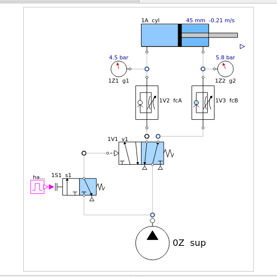
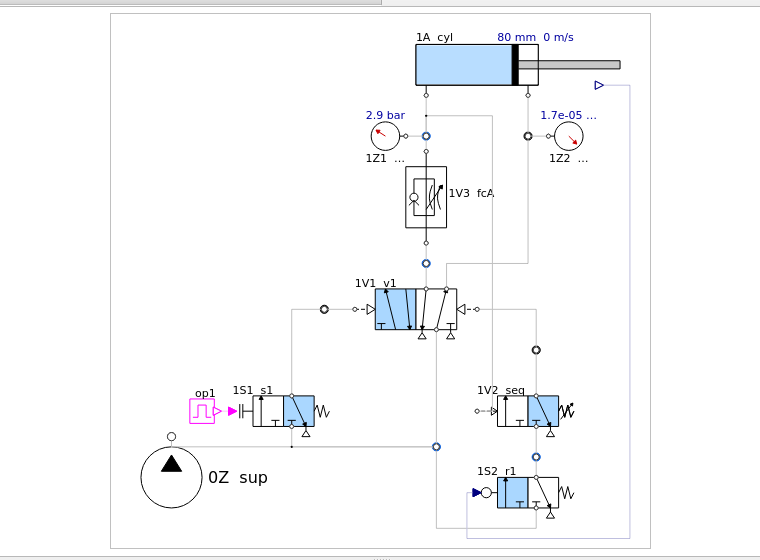

# Pneumatic circuits in OpenModelica

Pneumatic control circuits of a basic teaching kit, simulated from first principles with free
software: a Modelica library of valves, tubes and cylinders (ISO 6358 flow, polytropic volumes, a
cylinder with friction), eight lessons and three build-it-yourself exercises, three experiments
with 48 runs, and an independent Python implementation that reproduces every run. Circuits are
dragged, dropped, connected and run in OMEdit, OpenModelica's graphical editor, and **animate**
after a simulation: pistons move, chambers and lines fill with pressure, valves show their active
position, gauges read live ([learn](docs/LEARN.md)).

## Start in five minutes

1. **Get it:** green **Code** button above → **Download ZIP**, unzip.
2. **Install OpenModelica** (free): Windows installer from <https://openmodelica.org>; macOS and Linux
   via Docker. Step by step: **[install](docs/INSTALL.md)**.
3. **Open** `modelica/PneumaticCircuits/package.mo` in OMEdit → `Learn → Lessons → L01`, press
   **Simulate**, then **Diagram Window** and **Play**: the circuit runs.

Then follow the eight lessons and three exercises: **[learn](docs/LEARN.md)**.

| A lesson running in OMEdit (speed control, returning) | An experiment (pressure-dependent stamping, on the workpiece) |
|---|---|
|  |  |

Blue is compressed air: chambers and lines fill with it, a valve's blue square is its active
position, pistons move with the simulated position, gauges read the simulated pressure.

## What is in it

| | |
|---|---|
| **Library** | supply, tubes, 3/2 push-button, selector and roller valves, 5/2 selector, single- and double-pilot valves, AND and OR valves, one-way flow control, quick exhaust, pressure sequence valve, single- and double-acting cylinders, gauges |
| **Learn** | 8 lessons (direct and indirect control, OR, AND, speed control, quick exhaust, memory), 3 exercises with the parts placed but not connected, a sandbox |
| **Experiments** | the three below, 48 recorded runs |
| **Proof** | an independent Python implementation reproduces every run; 20 statements of the lessons checked against simulation; tests on Linux, Windows and macOS |


| Experiment | Circuit | What it shows |
|---|---|---|
| **E1** two-hand press | two push buttons → two-pressure (AND) valve → pilot 5/2-way valve; one-way flow control (meter-out) and quick-exhaust valve | the AND logic and its limits; stroke times against the throttle; what the quick-exhaust valve gains; gauge pressures |
| **E2** automatic reciprocation | selector switch, roller limit valves, double-pilot 5/2-way valve, two one-way flow controls | cycle time against the throttles; meter-in against meter-out under no load, an opposing load and an overrunning load |
| **E3** pressure-dependent stamping | push button, double-pilot 5/2-way valve, meter-in, pressure sequence valve gated by a roller valve | force control by a pressure setting, and what fails without the gate, with meter-out, or with the button held |

## Results in brief

- **Return speed under meter-out is set by the throttle alone:** v = C ρ0 R T0 / A, the
  conductance of the choked throttle over the piston area. The simulations match it within 1 %
  from 2.5 % to 30 % opening, at any supply from 3 to 6 bar ([E1](docs/EXPERIMENTS.md#e1-two-hand-press)).
- **The quick-exhaust valve** shortens the extension from 0.123 s to 0.094 s (−24 %); the return
  is unchanged.
- **A two-pressure valve is not a safety control:** it has no time window (a button pressed 1.5 s
  late still starts the press), and releasing a button mid-stroke does not stop a 94 ms stroke.
- **Meter-out holds the speed against the load** (−3 % with 60 N against it); meter-in follows
  the load (−42 %) and lets a pulling load run away (+30 %) ([E2](docs/EXPERIMENTS.md#e2-automatic-reciprocation)).
- **A pressure sequence valve sets the press force** F = p_set A1 − F_c (within 0.6 N from 2 to
  5 bar), provided the approach is metered in and the valve is enabled only near the work: the
  breakaway pressure peak and meter-out both defeat it ([E3](docs/EXPERIMENTS.md#e3-pressure-dependent-stamping)).

All are simulations; parameters without a datasheet are estimated, and their effect is
quantified ([sensitivity](docs/EXPERIMENTS.md#sensitivity)).

## Command line (optional)

Python 3.10+ (`pip install -r requirements.txt`). The scripts use an installed OpenModelica, or
its Docker image if none is installed; `--engine python` needs neither.

```bash
scripts/omedit.sh                     # Linux/macOS: OMEdit from the Docker image
python3 scripts/play.py TwoHandPress opening=0.1   # one run with your settings, plotted (--list shows them)
python3 scripts/run_lessons.py        # every lesson and variant, recorded; the lessons' statements checked
python3 scripts/run_experiments.py    # all 48 runs, OpenModelica and the Python twin (about 5 min)
python3 scripts/make_figures.py       # figures and circuit diagrams -> docs/img
python3 scripts/sensitivity.py        # parameter sensitivity -> results/tables/sensitivity.csv
python3 -m pytest tests               # tests (CI runs them on every push)
```


## Documentation

| | |
|---|---|
| [Install](docs/INSTALL.md) | Windows, macOS, Linux, step by step; troubleshooting |
| [Learn](docs/LEARN.md) | watch circuits run, the eight lessons with their recorded results, exercises, the sandbox |
| [Software](docs/SOFTWARE.md) | the free and commercial tools compared, and why OpenModelica |
| [Physics](docs/PHYSICS.md) | every equation, and the results they predict in closed form |
| [Components](docs/COMPONENTS.md) | the kit's parts, every parameter with its source and status |
| [Experiments](docs/EXPERIMENTS.md) | hypothesis, procedure, results, verification and sensitivity for each experiment |
| [For ENR312 students](docs/course/README.md) | which run serves which task of the course's pneumatics guideline |

## Repository

```
modelica/PneumaticCircuits/   the Modelica library: components (Valves, Actuators, Sources, ...), Learn (lessons, exercises, sandbox), Experiments
python/pneusim/               the Python twin (model.py, circuits.py), scenarios, metrics, diagram drawing, OpenModelica runner
scripts/                      play, run_lessons, run_experiments, make_figures, sensitivity, om.sh, omedit.sh
results/                      data/ (every run, 5 ms; lessons/), tables/ (lessons, claims, experiments, cross-check, sensitivity), RUN_INFO.json
docs/                         documentation and figures
tests/                        pytest suite
```

## Related

Other apparatus of the same laboratory, each in its own repository:
[DC servo control (Rhino RMCS-2303)](https://github.com/Samarth030312/rhino-rmcs-2303-dc-servo-control),
[temperature control (Arduino)](https://github.com/Samarth030312/arduino-temperature-control-lab),
[water-level control (Arduino)](https://github.com/Samarth030312/arduino-water-level-control-lab).

## Licence and trademarks

MIT ([LICENSE](LICENSE)). Third-party software and cited sources: [THIRD_PARTY.md](THIRD_PARTY.md).

Festo, Festo Didactic and FluidSIM are trademarks of Festo SE & Co. KG. This project is independent: it is not affiliated with, sponsored or endorsed by Festo. Festo part numbers and datasheets are cited only to identify where a parameter value comes from; no Festo text, drawing, software or datasheet is reproduced. The circuit symbols are drawn here after the ISO 1219-1 conventions.
