# Experiments and results

Three circuits, 48 simulated runs. Every number below is in `results/tables/` (one row per run)
and every curve in `results/data/<run>.csv`, written by `scripts/run_experiments.py`
(OpenModelica 1.27.1; run details in `results/RUN_INFO.json`). All runs: supply 6 bar (gauge)
unless stated, parameters as in [components](COMPONENTS.md), simulated with DASSL, tolerance
10⁻⁶, output every 2 ms (1 ms for E3). These are **simulations**: no run on a physical kit is
reported here.

Stroke times are measured from the command (the later of the two button presses, or the
release) to 99 % (extension) or 1 % (return) of the stroke; speeds are the mean between 20 % and
80 % of the stroke; pressures are gauge pressures.

## E1 Two-hand press

`Experiments.TwoHandPress`: two 3/2-way push-button valves (1S1, 1S2) feed a two-pressure valve
(1V1, AND) that pilots a 5/2-way valve with spring return (1V2). 1V2 feeds the cap side through
a one-way flow control valve (1V3: free in, throttled out, i.e. meter-out on the return) and the
rod side through a quick-exhaust valve (1V4). Gauges 1Z1 (cap side) and 1Z2 (rod side).

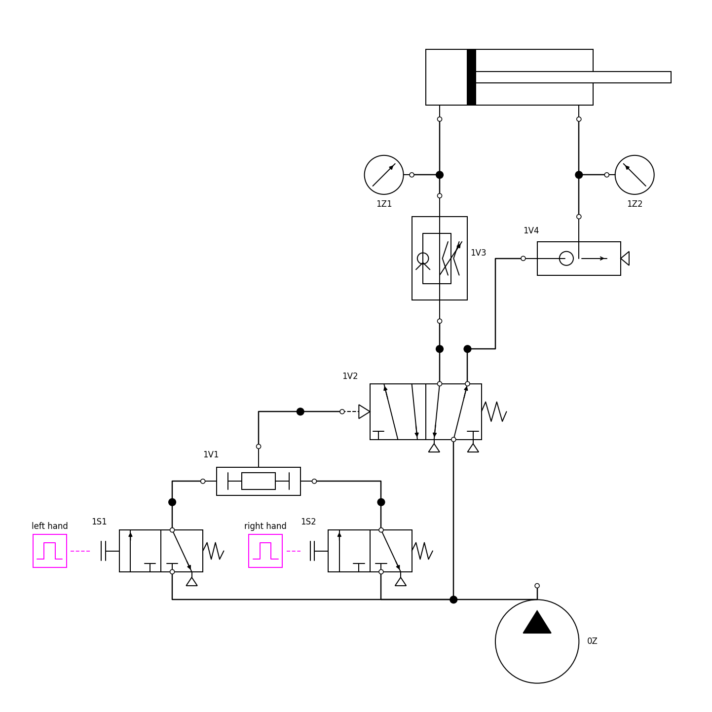

**Hypothesis.** The cylinder extends only while both buttons are held; it extends fast, because
1V4 dumps the rod side at the cylinder; it returns at a speed set by 1V3 alone,
v = C ρ0 R T0 / A1 ([physics §6](PHYSICS.md#6-results-this-predicts-in-closed-form)).

**Procedure.** Both buttons held from 1 s to 3 s (E1-01); each button alone (E1-02, E1-03); 1S2
released half way through the extension (E1-04); 1S2 pressed 1.5 s after 1S1 (E1-05); 1V3 at
100 % down to 2.5 % (E1-T); the rod side piped straight to 1V2 (E1-N); supply 3 to 6 bar (E1-P).

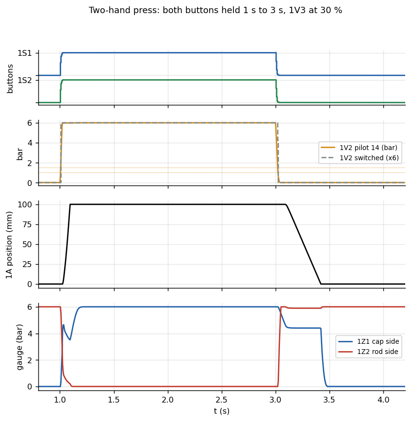

**Two-hand logic.** With one button only (E1-02, E1-03) the piston does not move: it stays
against its stop (the stop model yields 0.016 mm under the rod side's 158 N); 1V2's pilot stays at 0 bar because 1V1
connects its output to the vented input. With both, 1V2's pilot reaches the switching pressure
7.8 ms after the second press. The AND valve has **no time window**: pressing 1S2 1.5 s after
1S1 (E1-05) still starts the press, 95 ms after the second press. Releasing a button half way
through the 94 ms extension (E1-04) does **not** stop it: the pilot and the cap side need longer
to vent than the stroke needs to finish; the piston reaches 100 mm and only then returns.

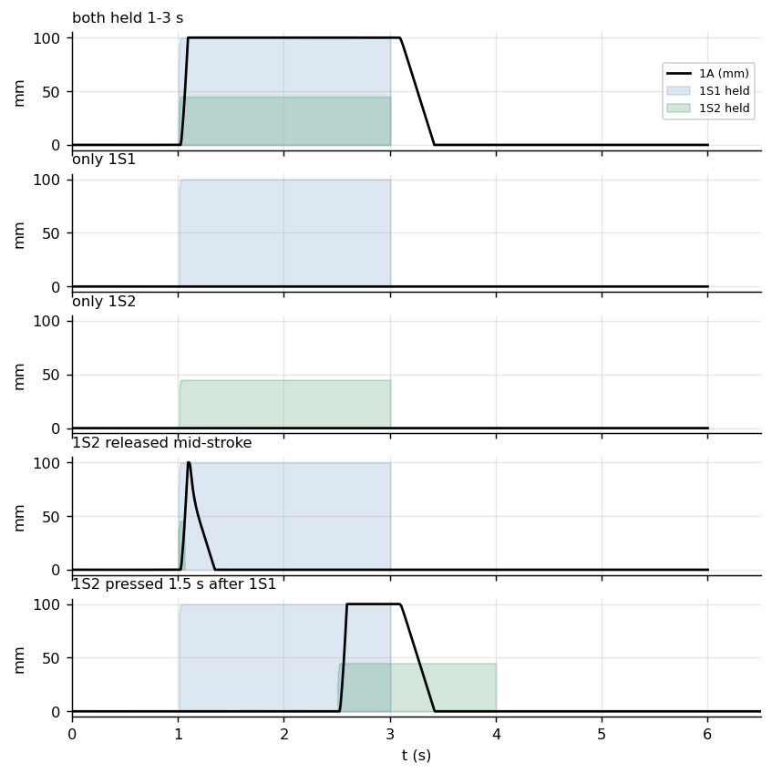

**Strokes, 1V3 at 30 % (E1-01).** The piston starts 32 ms after the second press (pilot, spool,
and the cap side rising until its force exceeds the rod side's) and reaches the end 94 ms after
it, peaking at 2.0 m/s. It starts back 108 ms after the release and is home 420 ms after it, at
0.315 m/s.

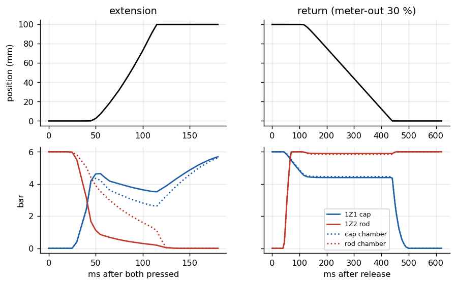

| | 1Z1 cap side | 1Z2 rod side |
|---|---:|---:|
| at rest, retracted | 0.00 bar | 6.00 bar |
| extending (chamber, mid-stroke) | 3.06 bar | 2.02 bar |
| extended, holding | 6.00 bar | 0.00 bar |
| returning (chamber, mid-stroke) | 4.45 bar | 5.84 bar |

Returning, the cap side is held at 4.45 bar by the throttle: the air the piston pushes out must
pass 1V3, and the pressure rises until the flow through it matches the piston's displacement.

**The throttle (E1-T).**

| 1V3 setting | 100 % | 70 % | 50 % | 30 % | 20 % | 10 % | 5 % | 2.5 % |
|---|---:|---:|---:|---:|---:|---:|---:|---:|
| return time (s) | 0.197 | 0.228 | 0.281 | 0.420 | 0.600 | 1.151 | 2.256 | 4.440 |
| return speed (m/s) | 0.798 | 0.648 | 0.506 | 0.315 | 0.211 | 0.106 | 0.053 | 0.026 |
| predicted v = C ρ0 R T0 / A1 (m/s) | 1.060 | 0.742 | 0.530 | 0.318 | 0.212 | 0.106 | 0.053 | 0.026 |
| delay before moving (s) | 0.072 | 0.072 | 0.084 | 0.108 | 0.132 | 0.240 | 0.420 | 0.780 |
| extension time (s) | 0.094 | 0.094 | 0.094 | 0.094 | 0.094 | 0.095 | 0.095 | 0.095 |

From 2.5 % to 30 % the return speed is the closed-form choked-flow speed within 1 % (5 % below it at 50 %): the
speed is proportional to the throttle's conductance, and the return time to its inverse. Above
50 % the throttle is no longer the only restriction (1V2, the port and the check path add up) and
the speed falls below the prediction. The extension does not depend on 1V3: its check valve
opens towards the cylinder. The delay before the return grows as the throttle closes: the cap
side must vent from 6 bar to about 4.5 bar through it before the piston can move.

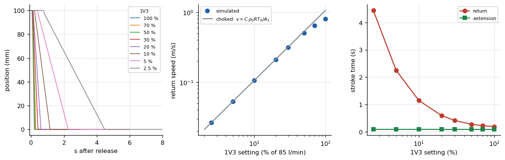

**The quick-exhaust valve (E1-N).** Without 1V4 the rod side's air leaves through the tube and
1V2's exhaust: extension 0.123 s instead of 0.094 s (+31 %), peak speed 1.34 instead of
2.00 m/s; mid-stroke the rod chamber holds 3.5 bar instead of 2.0 bar against the piston. The
return is unchanged (0.419 s at 30 %): 1V4 only acts when the rod side exhausts.

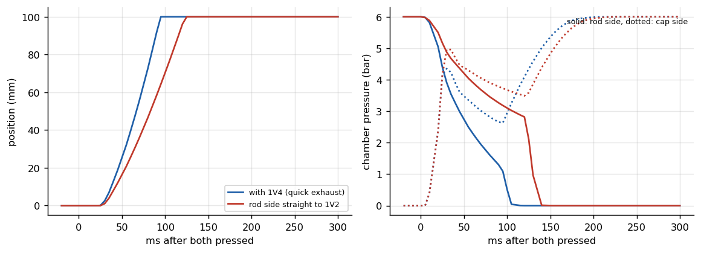

**Supply pressure (E1-P).** Extension 0.114, 0.104, 0.098, 0.094 s at 3, 4, 5, 6 bar; the return
speed stays 0.312–0.315 m/s: the choked meter-out speed does not depend on the pressure.

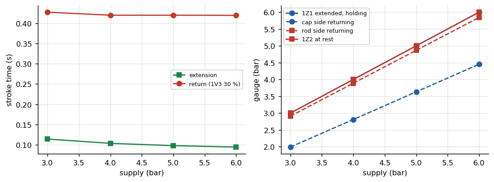

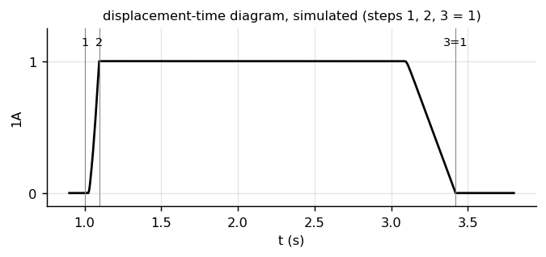

## E2 Automatic reciprocation

`Experiments.Reciprocating`: a 3/2-way selector switch (1S1, start) and a roller valve at the
retracted end (1S2) feed a two-pressure valve (1V4) that pilots 14 of a 5/2-way double-pilot
valve (1V1); a roller valve at the extended end (1S3) pilots 12. One one-way flow control on
each side (1V2, 1V3), meter-out or, reversed, meter-in.

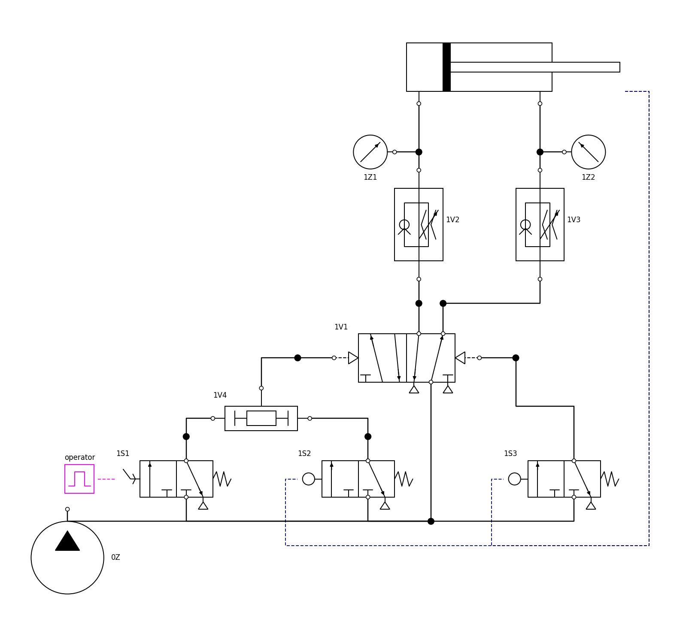

**Hypothesis.** The cylinder cycles while 1S1 is set and stops retracted when it is reset; with
meter-out, the speed in each direction is the choked speed of the throttle on the exhausting
side and hardly depends on the load; with meter-in, the speed depends on the load and an
overrunning load runs away.

**Procedure.** 1S1 set from 1 s to 6 s; both throttles 100 % to 10 % (E2-T); meter-in and
meter-out at 20 % with no load, with 3 kg extending downward, and with 60 N against extension
(E2-MI/MO, -V, -F).

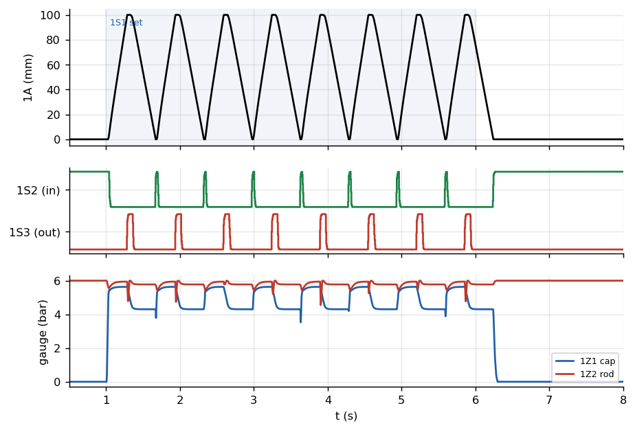

**Cycling (meter-out).** At 30 % / 30 %: 8 cycles of 0.656 s, extending at 0.389 m/s and
returning at 0.314 m/s; after 1S1 is reset the running cycle ends retracted (all runs stop
retracted).

| both throttles | 100 % | 50 % | 30 % | 20 % | 10 % |
|---|---:|---:|---:|---:|---:|
| cycle period (s) | 0.298 | 0.434 | 0.656 | 0.940 | 1.792 |
| extension speed (m/s) | 0.891 | 0.607 | 0.389 | 0.259 | 0.127 |
| return speed (m/s) | 0.781 | 0.500 | 0.314 | 0.211 | 0.106 |

Extending, the throttled air leaves the rod side (area A2), returning the cap side (A1): the
ratio of the speeds, 0.127/0.106 = 1.20 at 10 %, is A1/A2 = 1.19, as v = C ρ0 R T0 / A predicts.

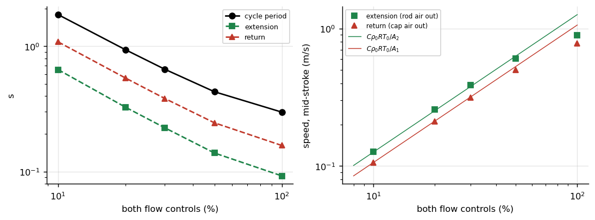

**Meter-in against meter-out (20 %).**

| load | extension speed, meter-in | meter-out | return speed, meter-in | meter-out |
|---|---:|---:|---:|---:|
| none, horizontal | 0.712 m/s | 0.259 m/s | 0.681 m/s | 0.211 m/s |
| 60 N against extension | 0.411 m/s (−42 %) | 0.250 m/s (−3 %) | 0.824 m/s | 0.214 m/s |
| 3 kg extending downward | 0.926 m/s (+30 %) | 0.312 m/s | 0.651 m/s | 0.221 m/s |

At the same setting meter-in is faster: the throttle passes the supply-side choked flow into a
chamber held only at the pressure the load needs. Its speed follows the load: −42 % with 60 N
against it, +30 % with a 3 kg mass pulling, which nothing on the outflow side holds back.
Meter-out keeps the speed within 3 % of its no-load value against 60 N. With the 3 kg mass,
meter-out oscillates on the air spring of the rod side (speed standard deviation 0.13 m/s
mid-stroke): the mass and the compressed air form a lightly damped spring-mass system.

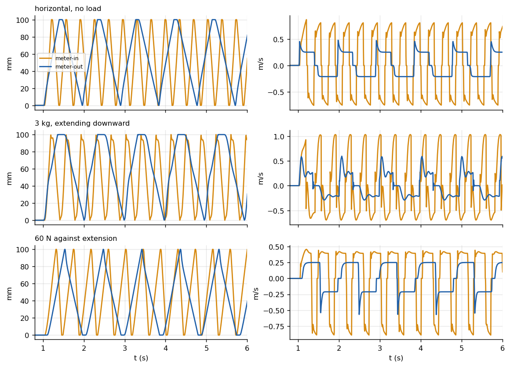

## E3 Pressure-dependent stamping

`Experiments.PressureStamp`: a push button (1S1) pilots 14 of a 5/2-way double-pilot valve (1V1);
the cap side is fed through a one-way flow control (1V3, meter-in). A pressure sequence valve
(1V2) senses the cap-side line between 1V3 and the cylinder and pilots 12; it is supplied
through a roller valve (1S2) that the piston actuates beyond 75 mm. A workpiece (stiffness
2·10⁵ N/m) sits at 80 mm. The start button is tapped for 50 ms.

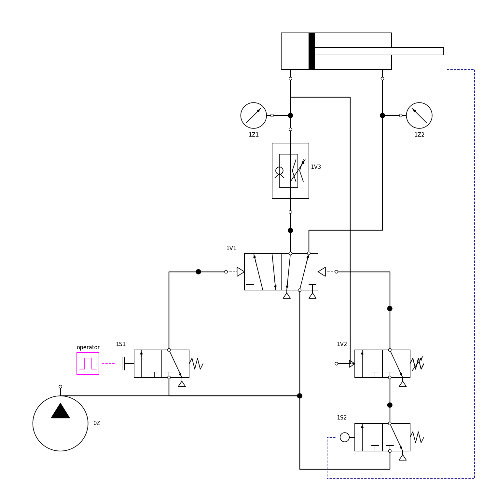

**Hypothesis.** During free motion the cap side holds only what friction needs; held by the
workpiece it rises, and at the setting p_set the cylinder returns: the force on the workpiece
is p_set A1 minus friction.

**Procedure.** Settings 1 to 5 bar with a slow approach (1V3 at 10 %, E3-P) and a fast one (30 %,
E3-F); without the roller gate at 2 and 4 bar; meter-out instead of meter-in; the button held
1 s to 2.5 s; no workpiece.

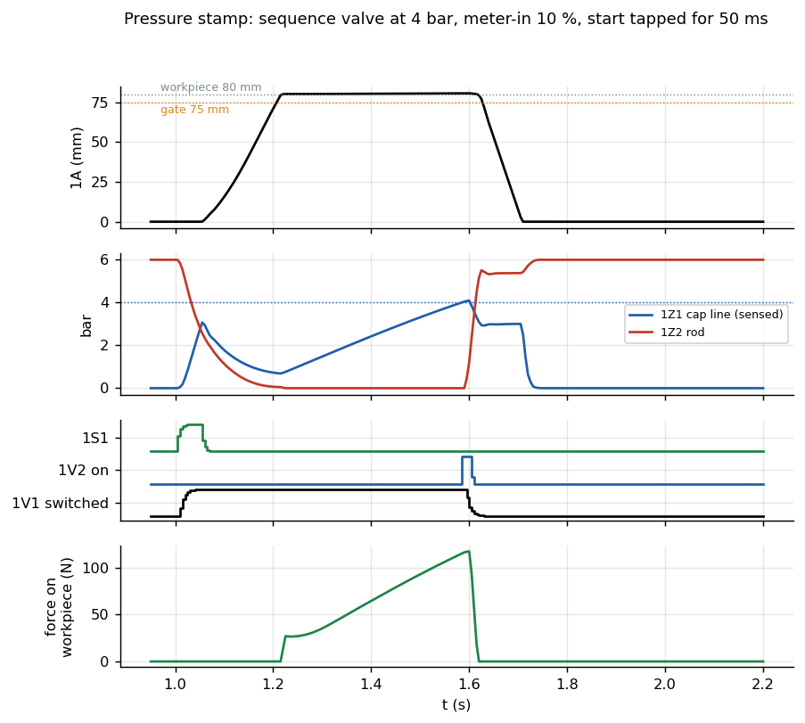

**Force against setting.** At 4 bar (E3-01) the piston meets the workpiece at 1.216 s, the cap
side rises through the 10 % throttle, and 1V1 reverses at 1.600 s with 117.5 N on the workpiece
(4.10 bar at the gauge).

| setting (bar) | 1 | 2 | 3 | 4 | 5 |
|---|---:|---:|---:|---:|---:|
| force at reversal, slow approach (N) | 27.7 | 54.4 | 85.7 | 117.5 | 149.7 |
| p_set A1 − F_c (N) | 23.4 | 54.8 | 86.2 | 117.7 | 149.1 |
| force at reversal, fast approach (N) | 42.1 | 42.1 | 86.5 | 118.1 | 149.2 |
| pressing time, slow (s) | 0.10 | 0.22 | 0.35 | 0.48 | 0.65 |

From 2 bar up, the slow approach gives F = p_set A1 − F_c within 0.6 N (F_c = 8 N, the sliding
friction). At 1 bar the setting is below the 1.2–1.9 bar the cap side holds just to move the
piston: the sequence valve is already switched when the roller gate opens, and the return
starts at the gate, not at a force. With the fast approach the same happens up to 2 bar (42 N,
set by when the reversal catches the piston, not by the setting); from 3 bar the force follows
the setting again.

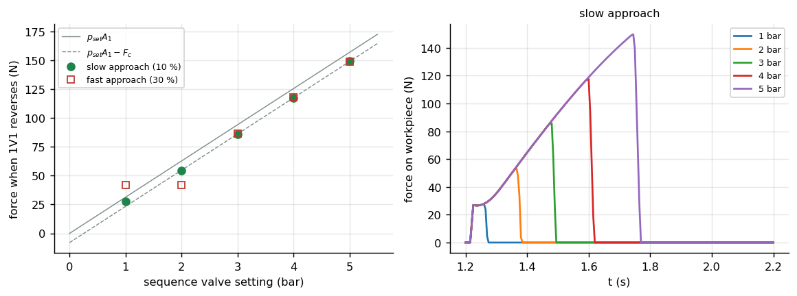

**What goes wrong without each design choice.**

| variant | result |
|---|---|
| no roller gate, 2 bar (E3-NOGATE2) | returns at 6.9 mm, never reaches the workpiece: to break away, the cap side must exceed the rod side's held pressure, a 3.2 bar peak that switches the sequence valve at once |
| no roller gate, 4 bar (E3-NOGATE4) | as gated (117.5 N): the start-up peak stays below 4 bar |
| meter-out instead (E3-MO) | the cap side stays near supply pressure during the whole stroke; the sequence valve is switched before contact, the return starts at the gate, and the piston coasts onto the workpiece: 72.5 N, set by its speed, not by the setting |
| button held 1 s to 2.5 s (E3-HOLD) | a double-pilot valve cannot reverse while pilot 14 is held: it presses until the release, the force rising to 188.5 N (the full supply force) |
| no workpiece (E3-NOWP) | extends to the end stop; the cap side reaches 4 bar there and the cylinder returns: the circuit also returns at the end of the stroke |

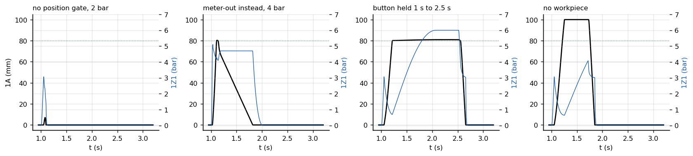

## Verification

**OpenModelica against the Python twin.** Every one of the 48 runs was repeated in the
independent Python implementation (`python/pneusim/model.py`, SciPy LSODA, relative tolerance
10⁻⁷) and compared at OpenModelica's output times (`results/tables/crosscheck.csv`): the largest
difference in position over all runs is 0.0095 mm, in either chamber pressure 0.0046 bar, and
the measured quantities (stroke times, periods, speeds, forces) agree within 0.005 %.

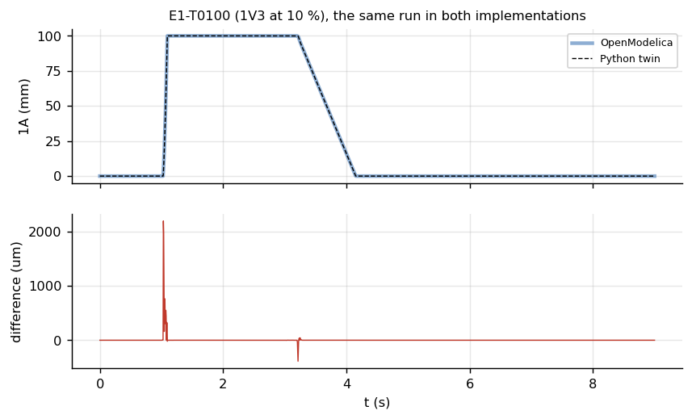

**Against closed form.** Choked meter-out speed (E1-T, E2-T), its independence from the supply
pressure (E1-P), the speed ratio A1/A2 (E2-T) and the holding forces (189 N, 158 N from the
datasheet; 188.5 N measured in E3-HOLD) all agree, as stated above.

**Tests** (`tests/`, run by CI): the flow law, the conductance conversion, the closed-form
meter-out speed, the datasheet forces, one button not moving the press, every diagram line ending
on its port, every model checking in OpenModelica, the twin's parameters equal to the compiled
model's, and three runs (E1-T0100, E2-01, E3-01) agreeing within 0.05 mm and 0.02 bar.

**Not verified: a physical kit.** No run on real hardware is reported. The ESTIMATED parameters
(below) are the main uncertainty.

## Sensitivity

Each ESTIMATED quantity halved and doubled (or set to its physical bounds), the rest nominal
(`scripts/sensitivity.py`, `results/tables/sensitivity.csv`). Change of the E1 extension time,
E1 return time and speed (1V3 30 %), and the E3 force at reversal (4 bar):

| quantity | extension | return time | return speed | stamp force |
|---|---:|---:|---:|---:|
| cylinder port flow ×0.5 / ×2 | +48 % / −19 % | +4 % / −1 % | −3 % / +1 % | 0 % |
| 5/2 valve flow ×0.5 / ×2 | +15 % / −6 % | +6 % / −1 % | −3 % / 0 % | 0 % |
| friction ×0.5 / ×2 | −6 % / +14 % | −3 % / +6 % | 0 % | +4 % / −9 % |
| critical ratio b 0.2 / 0.5 | −2 % / +6 % | −5 % / +14 % | +5 % / −13 % | 0 % |
| tube volumes ×0.5 / ×2 | −4 % / +8 % | −2 % / +4 % | 0 % | 0 % |
| polytropic n 1.0 / 1.4 | +5 % / −4 % | +4 % / −3 % | 0 % | +1 % / 0 % |
| quick-exhaust flow ×0.5 / ×2 | +6 % / 0 % | 0 % | 0 % | 0 % |
| signal valves flow ×0.5 / ×2 | +4 % / −3 % | +3 % / −2 % | 0 % | 0 % |
| pilot switching 1.0/0.5 or 2.5/1.5 bar | −2 % / +3 % | +1 % / −1 % | 0 % | 0 % |
| moving mass ×0.5 / ×2 | 0 % / +2 % | 0 % | 0 % | 0 % |

The extension time depends mostly on the flow capacity of the cylinder port and the 5/2 valve
(estimated): it is the least certain result, to within about −20 %/+50 %. The return speed
depends on the throttle's conductance (from its datasheet) and the critical ratio b (estimated):
within about ±14 %. The stamp force depends on friction only: it is p_set A1 − F_c.
