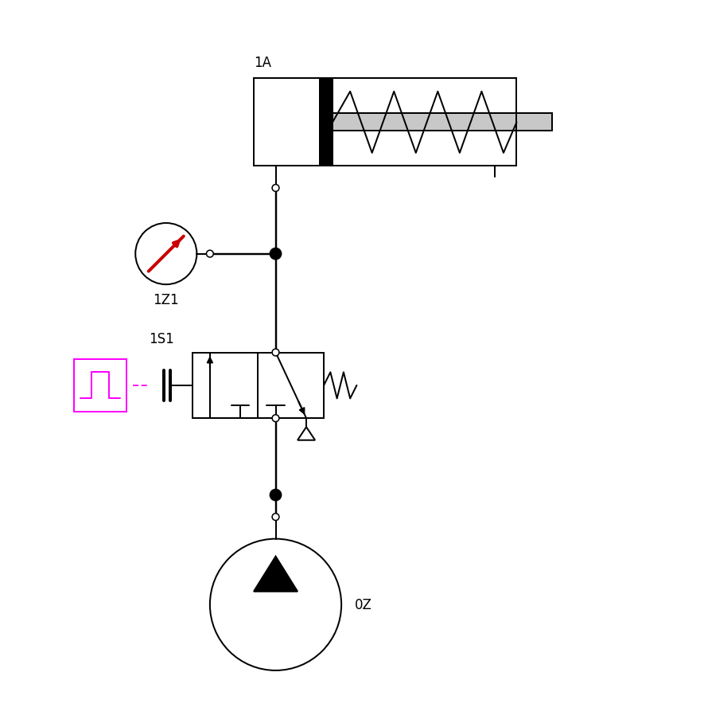
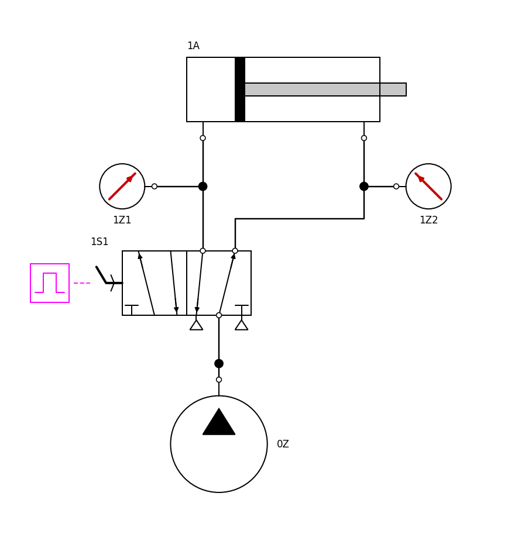
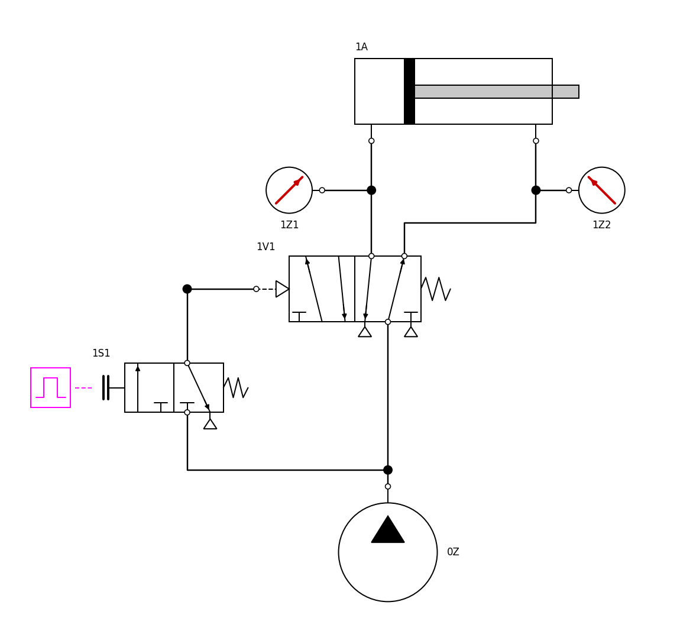
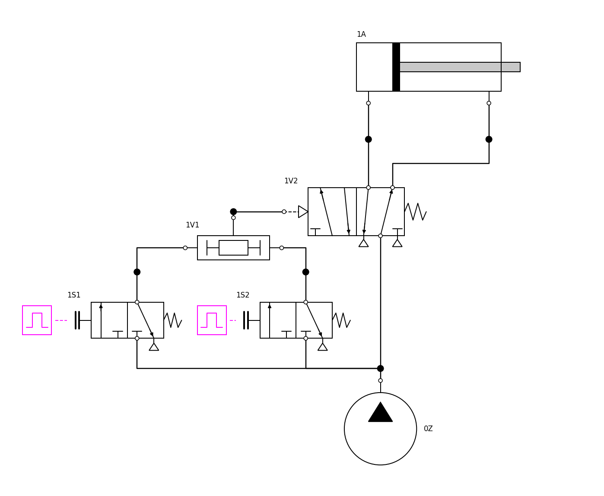
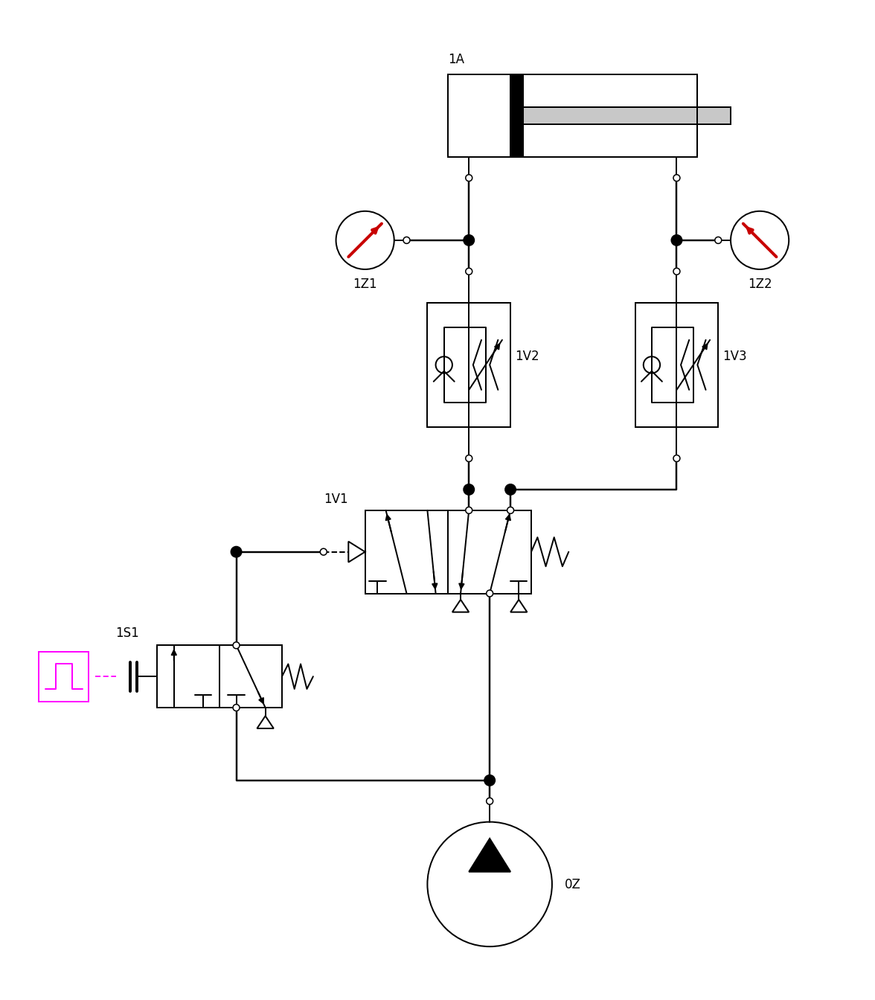
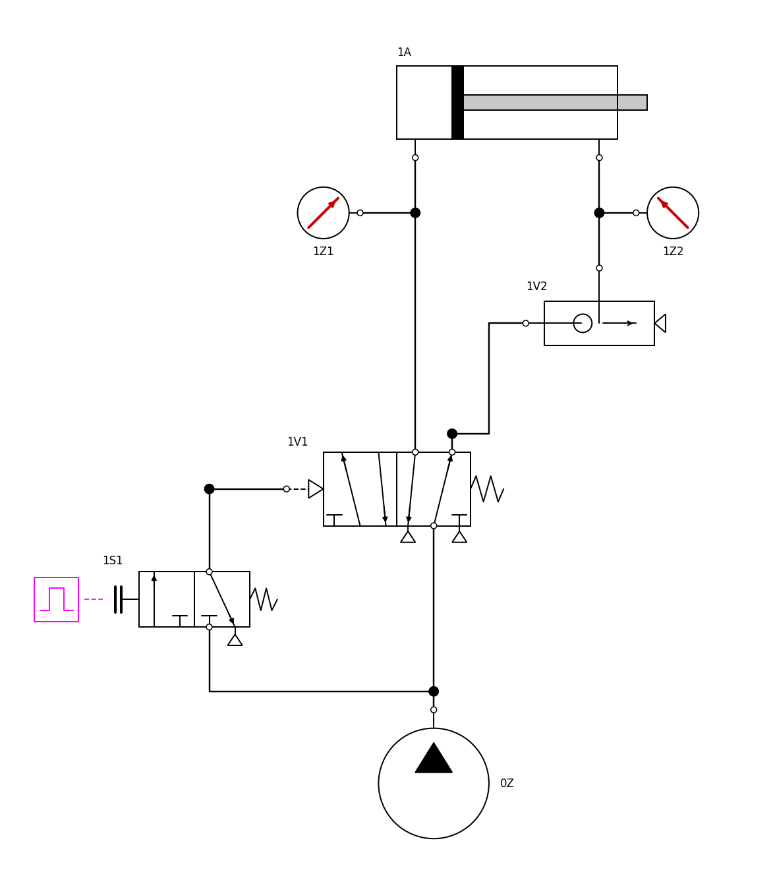
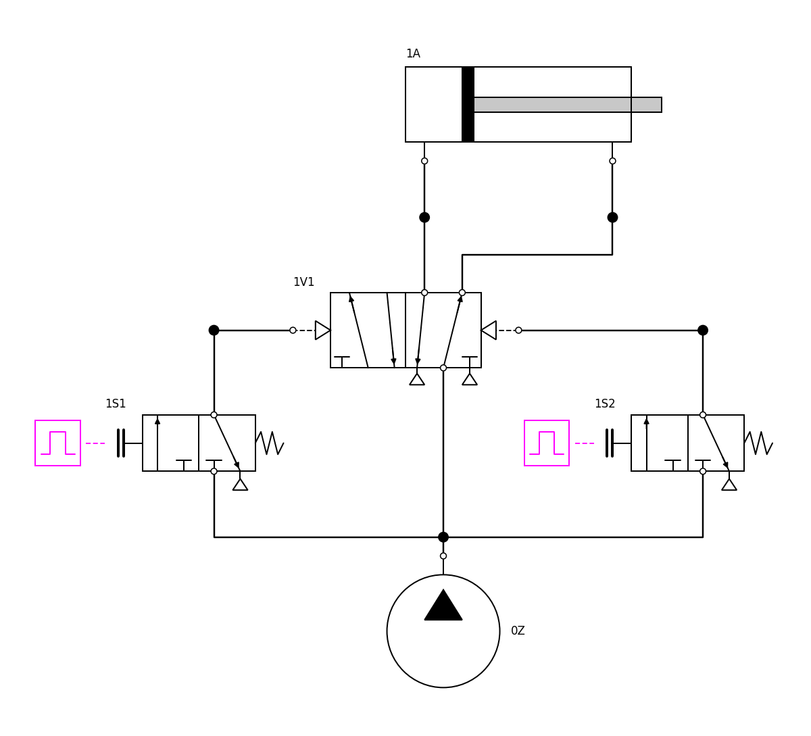

# Learn pneumatics with the library

The library is meant to be played with: open a circuit, run it, watch it move, change it, build
your own. Everything below happens in OMEdit, OpenModelica's graphical editor (`scripts/omedit.sh`,
or OpenModelica installed on Windows or macOS).

## Watch a circuit run

1. In **Libraries**, expand **PneumaticCircuits → Learn → Lessons** and double-click a lesson.
2. **Simulation → Simulate** (the green arrow).
3. In the **Plotting** perspective (bottom right), press **Diagram Window** in the toolbar.
4. Press **Play** (top right, next to *Time*), or type a time.

What the animation shows:

| On the diagram | Means |
|---|---|
| a valve's square turns blue | that position is the active one |
| a push button turns red, its operator says *pressed* | the button is being held |
| a tube junction turns blue | that line is above 0.5 bar |
| the cylinder's chambers fill blue, darker with pressure | chamber pressure; the piston and rod move with the real position |
| the cylinder's label | position (mm) and speed (m/s) |
| a gauge's red needle and number | the line's gauge pressure (0–10 bar dial) |
| an AND/OR body turns blue | its output is pressurised |
| a one-way flow control's ball turns blue | its check valve is open (free flow) |
| a quick-exhaust valve's triangle turns blue | it is exhausting the cylinder directly |

Any variable can also be plotted: tick it in the Variables browser (pressures in Pa, positions in
m, `xv` = valve spool position 0 to 1).

## The lessons, in order

Each lesson's documentation (the *i* button, or the Documentation view) says what you learn, what
to watch, and what to change; each change has an expected outcome you can check.

| Lesson | Idea | Circuit |
|---|---|---|
| **L01** Direct control, single-acting | the 3/2-way valve; ports 1, 2, 3; spring return |  |
| **L02** Direct control, double-acting | the 5/2-way valve; air drives both strokes |  |
| **L03** Indirect control | signal valve and power valve; pilot delay and hysteresis |  |
| **L04** OR | the shuttle valve; why not a plain junction |  |
| **L05** AND | the two-pressure valve; the core of a two-hand control |  |
| **L06** Speed control | meter-out and meter-in; v = C ρ0 R T0 / A |  |
| **L07** Quick exhaust | exhausting at the cylinder |  |
| **L08** Memory | the double-pilot valve; overlapping signals |  |

Simulated, with the default settings (6 bar): L01 extends in 27 ms and the spring returns it in
138 ms; L03 starts 8 ms later than L02 (the pilot must fill); L05 starts only when the second
hand arrives (1.53 s); L07 extends in 62 ms against 87 ms without the quick-exhaust valve (L03);
L08 stays extended after a tap on start, returns after a tap on return, and stays extended when
the two signals overlap.

Then the full experiments ([results](EXPERIMENTS.md)): `Experiments.TwoHandPress`,
`Experiments.Reciprocating`, `Experiments.PressureStamp`.

## Build your own

**Exercises** (`Learn.Exercises`) place the parts of a circuit without connections: X01 direct control,
X02 a two-hand control with speed control, X03 an automatic reciprocation with roller valves. Draw
the connections (hover a port until the cursor becomes a cross, drag to the other port), simulate,
compare with the solution named in the exercise.

**Sandbox** (`Learn.Sandbox`): a supply and nothing else. Duplicate it (right-click → Duplicate) and
drag parts from `Valves`, `Actuators`, `Sensors` and `Signals`. Three rules:

1. Every net (connection point) needs exactly **one Tube**: valve and cylinder ports never connect
   to each other directly. The tube is the line's air volume.
2. Push buttons and selector switches are operated by a **Signals.Schedule** (press and release times).
3. Roller valves take the cylinder's position: connect the cylinder's blue output triangle to the
   roller's input and set `x_trip`.

Set a part's `tag` (for example `1V1`) to label it as in a circuit diagram. Every component's
documentation explains its symbol, its ports and the equation it obeys ([physics](PHYSICS.md)).
