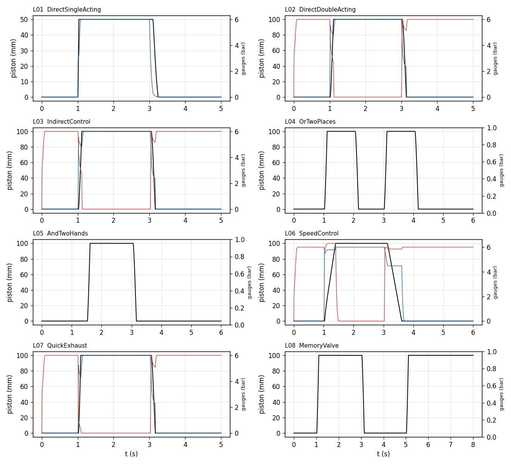

# Learn pneumatics with the library

The library is meant to be played with: open a circuit, run it, watch it move, change it, build
your own. Everything below happens in OMEdit, OpenModelica's graphical editor (`scripts/omedit.sh`,
or OpenModelica installed on Windows or macOS).

## Watch a circuit run

1. In **Libraries**, expand **PneumaticCircuits → Learn → Lessons** and double-click a lesson.
2. **Simulation → Simulate** (the green arrow).
3. In the **Plotting** perspective (bottom right), press **Diagram Window** in the toolbar.
4. Press **Play** (top right, next to *Time*), or type a time.

What the animation shows:

| On the diagram | Means |
|---|---|
| a valve's square turns blue | that position is the active one |
| a push button turns red, its operator says *pressed* | the button is being held |
| a tube junction turns blue | that line is above 0.5 bar |
| the cylinder's chambers fill blue, darker with pressure | chamber pressure; the piston and rod move with the real position |
| the cylinder's label | position (mm) and speed (m/s) |
| a gauge's red needle and number | the line's gauge pressure (0–10 bar dial) |
| an AND/OR body turns blue | its output is pressurised |
| a one-way flow control's ball turns blue | its check valve is open (free flow) |
| a quick-exhaust valve's triangle turns blue | it is exhausting the cylinder directly |

Any variable can also be plotted: tick it in the Variables browser (pressures in Pa, positions in
m, `xv` = valve spool position 0 to 1).

## The lessons, in order

Each lesson's documentation (the *i* button, or the Documentation view) says what you learn, what
to watch, and what to change; each change has an expected outcome you can check.

| Lesson | Idea | Circuit |
|---|---|---|
| **L01** Direct control, single-acting | the 3/2-way valve; ports 1, 2, 3; spring return |  |
| **L02** Direct control, double-acting | the 5/2-way valve; air drives both strokes |  |
| **L03** Indirect control | signal valve and power valve; pilot delay and hysteresis |  |
| **L04** OR | the shuttle valve; why not a plain junction |  |
| **L05** AND | the two-pressure valve; the core of a two-hand control |  |
| **L06** Speed control | meter-out and meter-in; v = C ρ0 R T0 / A |  |
| **L07** Quick exhaust | exhausting at the cylinder |  |
| **L08** Memory | the double-pilot valve; overlapping signals |  |

### Recorded results

Every lesson and every *Try this* variant was run (`scripts/run_lessons.py`; data in
`results/data/lessons/`, table `results/tables/lessons.csv`). Times are from the start of the run;
the operator presses at 1 s.

| Run | Settings | Starts out (s) | Extension (s) | Return (s) | Strokes |
|---|---|---:|---:|---:|---:|
| L01 | defaults | 1.008 | 0.0272 | 0.14 | 1 |
| L01-1bar | sup.p_gauge=100000.0 | 1.016 | 0.266 | 0.14 | 1 |
| L01-stiff | cyl.k_spring=3000 | 1.008 | 0.072 | 0.106 | 1 |
| L01-short | hand.t_off[1]=1.015 | 1.008 | 0.024 | 0.104 | 1 |
| L02 | defaults | 1.02 | 0.087 | 0.0987 | 1 |
| L02-heavy | cyl.m=5 | 1.028 | 0.1104 | 2.026 | 2 |
| L02-small | v1.qn=30 | 1.038 | 0.252 | 0.302 | 1 |
| L03 | defaults | 1.028 | 0.0871 | 0.0995 | 1 |
| L03-10m | tP.L=10 | 1.054 | 0.0871 | 0.099 | 1 |
| L03-stiff | v1.p_on=400000.0 sup.p_gauge=300000.0 | - | - | - | 0 |
| L04 | defaults | 1.03 | 0.086 | 0.0995 | 2 |
| L04-overlap | hand2.t_on[1]=1.5 | 1.03 | 0.086 | 0.0995 | 1 |
| L05 | defaults | 1.53 | 0.086 | 0.0995 | 1 |
| L05-apart | hand2.t_on[1]=3.5 | - | - | - | 0 |
| L06 | defaults | 1.032 | 0.364 | 0.466 | 1 |
| L06-5pc | openingA=0.05 | 1.032 | 0.364 | 1.836 | 1 |
| L06-in | meterIn=true | 1.046 | 0.1599 | 0.1729 | 1 |
| L06-in-60N | meterIn=true cyl.F_load=60 | 1.06 | 0.254 | 0.1389 | 1 |
| L06-out-60N | cyl.F_load=60 | 1.118 | 0.41 | 0.43 | 1 |
| L07 | defaults | 1.026 | 0.0616 | 0.1 | 1 |
| L08 | defaults | 1.028 | 0.0871 | 0.0986 | 2 |
| L08-longer | handReturn.t_off[2]=7.5 | 1.028 | 0.0871 | 0.0986 | 2 |

Each statement the lessons make was checked against these runs (`results/tables/lesson_claims.csv`):

| Lesson | Statement in the lesson | Simulated | Check |
|---|---|---|---|
| L01 | the spring return is slower than the extension | extend 0.0272 s, return 0.14 s | PASS |
| L01 | at 1 bar it still reaches the end, much more slowly: 1 bar x A = 31.4 N, just above spring 25 N + friction 6 N | x max 50.0 mm, extend 0.266 s vs 0.0272 s | PASS |
| L01 | a stiffer spring returns faster | return 0.106 s vs 0.14 s | PASS |
| L01 | released after 15 ms the piston stops part-way and comes back | x max 33.43 mm | PASS |
| L02 | a 5 kg tool overshoots into the end stop (rebounds) | x max 100.63 mm | PASS |
| L02 | a small valve (30 l/min) slows both strokes | extend 0.252 vs 0.087 s, return 0.302 vs 0.0987 s | PASS |
| L03 | indirect control starts later than direct control (pilot filling) | 1.028 s vs 1.02 s | PASS |
| L03 | a 10 m pilot line starts the cylinder later | 1.054 s vs 1.028 s | PASS |
| L03 | pilot needing 4 bar on a 3 bar supply: nothing moves | x max 0.0 mm | PASS |
| L04 | either station extends the cylinder (two strokes) | 2 strokes | PASS |
| L04 | overlapping presses give one longer stroke, nothing new | 1 strokes | PASS |
| L05 | the cylinder starts only when the second hand arrives (1.5 s) | starts 1.53 s | PASS |
| L05 | hands that never overlap: no motion | x max 0.0 mm | PASS |
| L06 | a quarter of the opening (20 % to 5 %): the return takes about four times longer | return 1.836 s vs 0.466 s, ratio 3.94 | PASS |
| L06 | meter-in is faster at the same settings | extend 0.1599 s vs 0.364 s | PASS |
| L06 | a 60 N load slows meter-in far more than meter-out | extend time x1.59 (meter-in) vs x1.13 (meter-out) | PASS |
| L07 | the quick-exhaust valve shortens the extension (vs L03) | 0.0616 s vs 0.0871 s | PASS |
| L08 | a tap on start keeps it extended after the release; a tap on return brings it back | back at 3.046 s | PASS |
| L08 | overlapping signals: still extended at the end | x end 100.02 mm | PASS |
| L08 | return held until 7.5 s: it returns when start is released at 7 s | x at 7.4 s -0.0 mm | PASS |

Then the full experiments ([results](EXPERIMENTS.md)): `Experiments.TwoHandPress`,
`Experiments.Reciprocating`, `Experiments.PressureStamp`.

## Build your own

**Exercises** (`Learn.Exercises`) place the parts of a circuit without connections: X01 direct control,
X02 a two-hand control with speed control, X03 an automatic reciprocation with roller valves. Draw
the connections (hover a port until the cursor becomes a cross, drag to the other port), simulate,
compare with the solution named in the exercise.

**Sandbox** (`Learn.Sandbox`): a supply and nothing else. Duplicate it (right-click → Duplicate) and
drag parts from `Valves`, `Actuators`, `Sensors` and `Signals`. Three rules:

1. Every net (connection point) needs exactly **one Tube**: valve and cylinder ports never connect
   to each other directly. The tube is the line's air volume.
2. Push buttons and selector switches are operated by a **Signals.Schedule** (press and release times).
3. Roller valves take the cylinder's position: connect the cylinder's blue output triangle to the
   roller's input and set `x_trip`.

Set a part's `tag` (for example `1V1`) to label it as in a circuit diagram. Every component's
documentation explains its symbol, its ports and the equation it obeys ([physics](PHYSICS.md)).
