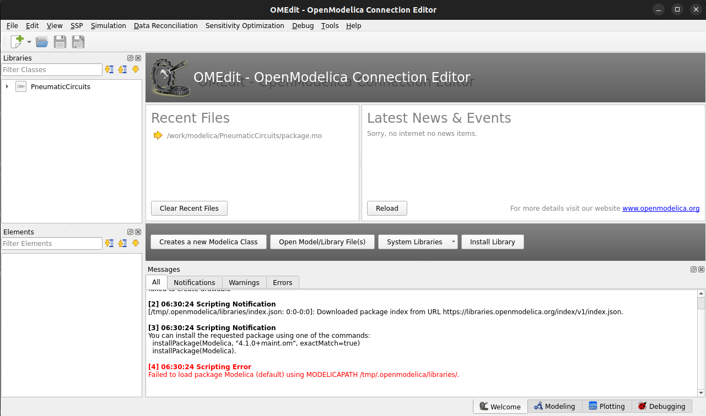

# Software: what was evaluated and why OpenModelica

The requirement: simulate the pneumatic circuits of a teaching kit (push-button, roller and pilot
valves, AND and OR valves, one-way flow control, quick exhaust, pressure sequence valve,
double-acting cylinder, gauges) with pressures and stroke times that can be trusted, on Linux,
with no paid licence.

| Tool | Licence, cost | What it offers for this | Why not (alone) |
|---|---|---|---|
| Festo FluidSIM | proprietary, paid | the kit maker's own simulator and symbols | no licence available |
| Automation Studio | proprietary, paid | ISO 1219 circuits, dynamic simulation | no licence available |
| [Hopsan](https://github.com/Hopsan/hopsan) 2.24.4 (Linköping University) | Apache-2.0, free; Ubuntu 22.04 package | fluid-power system simulation, graphical editor | its pneumatic library holds an orifice, a volume, sources, sensors and one machine: no cylinder, directional, AND/OR or quick-exhaust valves; each would be written in C++ |
| [Picuino pneumatic simulator](https://www.picuino.com/neumatic/) | GPL-3, browser | ISO 1219 drawing and animation for teaching; 3/2, 4/2, 5/2 manual, pilot and roller valves, check, choke, AND, OR, cylinders, gauge | no quick-exhaust or one-way flow control valve as a unit, no pressure-time plots (per its documentation): cannot answer timing and pressure questions |
| Open FluidSim (Unity) | open source | basic teaching simulator | little development since about 2018 |
| MechSimulator | free web service, not open source | ISO 1219 circuit builder | not open: the physics cannot be inspected |
| **[OpenModelica](https://openmodelica.org) 1.27.1** | **free, open source (OSMC-PL / GPL-3)** | equation-based modelling of any physics, graphical editor (OMEdit) with icons and connections, plots, scripting | **no pneumatic components ship with it**: written here |

**Chosen: OpenModelica with this repository's library `PneumaticCircuits`.** The components are a
few hundred lines of readable equations ([physics](PHYSICS.md)), the circuits are drawn and run in
OMEdit as in FluidSIM, every parameter is visible, and the same files run from a script. An
independent Python implementation of the same equations (`python/pneusim/model.py`) checks the
OpenModelica results run by run ([verification](EXPERIMENTS.md#verification)).

## Installed on this computer (Ubuntu 22.04, no administrator rights needed)

OpenModelica runs from its official container images, pulled once:

```bash
docker pull openmodelica/openmodelica:v1.27.1-minimal   # compiler and simulator (scripts, CI)
docker pull openmodelica/openmodelica:v1.27.1-gui       # adds OMEdit, 3.4 GB
```

`scripts/om.sh` runs the compiler, `scripts/omedit.sh` opens OMEdit on this library. On Windows
and macOS, install OpenModelica from <https://openmodelica.org/download/> and open
`modelica/PneumaticCircuits/package.mo` in OMEdit; the Python scripts are optional.



The library uses no other Modelica library: OMEdit's start-up message that the Modelica
Standard Library cannot be loaded is harmless.
